<div align="center">
  
  <h1>SCHEDULEOS</h1>
  <p><strong>SMART APPOINTMENT MANAGER</strong></p>
  <p><em>Every Appointment. Perfectly Organized.</em></p>
  <p>A modern, offline-first Windows desktop application for appointment scheduling, customer management, staff coordination, payments, and day-to-day business operations.</p>
</div>

<p align="center">
  <a href="#overview">Overview</a> ·
  <a href="#inside-scheduleos">Preview</a> ·
  <a href="#smart-scheduling-engine">Scheduling engine</a> ·
  <a href="#getting-started">Getting started</a> ·
  <a href="#application-gallery">Gallery</a>
</p>

<p align="center">
  
  
  
  
  
  
  
</p>

<p align="center">
  <a href="docs/FINAL_ACCEPTANCE_REPORT.txt">Acceptance report</a> ·
  <a href="docs/acceptance/ui-journey.log">UI journey evidence</a> ·
  <a href="build/packaging/ScheduleOS.iss">Installer script</a>
</p>

<a id="overview"></a>
## Overview

ScheduleOS is a native C# Windows desktop application for service businesses that need a dependable local workspace for appointments, people, resources, payments, and reporting.

It is designed around a focused offline-first workflow:

- A native WPF interface with a dense, business-oriented desktop layout.
- SQLite persistence kept in the Windows per-user data area.
- A layered MVVM architecture separating desktop presentation, application workflows, domain rules, and infrastructure adapters.
- Scheduling rules enforced in the business and persistence layers, not only in the UI.
- Backup and restore with SQLite online backup and integrity verification.

The screenshots in this README are real acceptance captures from the application using fictional demo records. No public download URL or GitHub Release is implied by this repository presentation.

<a href="assets/readme/scheduleos-dashboard-1440x900.png">
  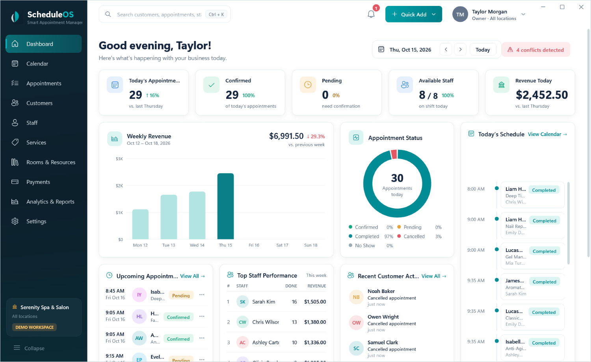
</a>

<p align="center"><sub>Real ScheduleOS WPF dashboard · fictional demo workspace · <a href="docs/screenshots/01-dashboard-1440x900.png">open the original capture</a></sub></p>

## Table of contents

- [Inside ScheduleOS](#inside-scheduleos)
- [Features](#features)
- [Smart Scheduling Engine](#smart-scheduling-engine)
- [Technology Stack](#technology-stack)
- [Architecture](#architecture)
- [Windows Desktop Release](#windows-desktop-release)
- [Getting Started](#getting-started)
- [Local Data Storage](#local-data-storage)
- [Testing and Quality Assurance](#testing-and-quality-assurance)
- [Project Structure](#project-structure)
- [Application Gallery](#application-gallery)
- [Project Status](#project-status)
- [Roadmap](#roadmap)

<a id="inside-scheduleos"></a>
## Inside ScheduleOS

The product is organized as a practical workstation rather than a collection of disconnected screens.

<table>
  <tr>
    <td width="50%">
      <h3>01 — Business Dashboard</h3>
      <p>Appointment KPIs, revenue trends, appointment status, staff performance, recent customer activity, and today's schedule are visible from one working surface.</p>
    </td>
    <td width="50%"><a href="assets/readme/scheduleos-dashboard-1440x900.png"></a></td>
  </tr>
  <tr>
    <td><a href="assets/readme/scheduleos-calendar-week.png">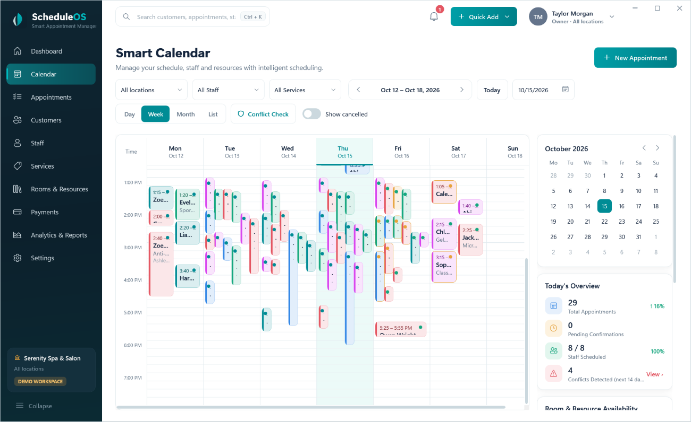</a></td>
    <td>
      <h3>02 — Smart Calendar</h3>
      <p>Day, week, month, and list-oriented scheduling views provide a working view of appointments, staff, resources, availability, and conflicts.</p>
    </td>
  </tr>
  <tr>
    <td>
      <h3>03 — Appointment Management</h3>
      <p>Create, inspect, confirm, reschedule, and settle appointments with customer, service, staff, resource, timing, conflict, payment, and invoice context.</p>
    </td>
    <td><a href="assets/readme/scheduleos-appointment-detail.png">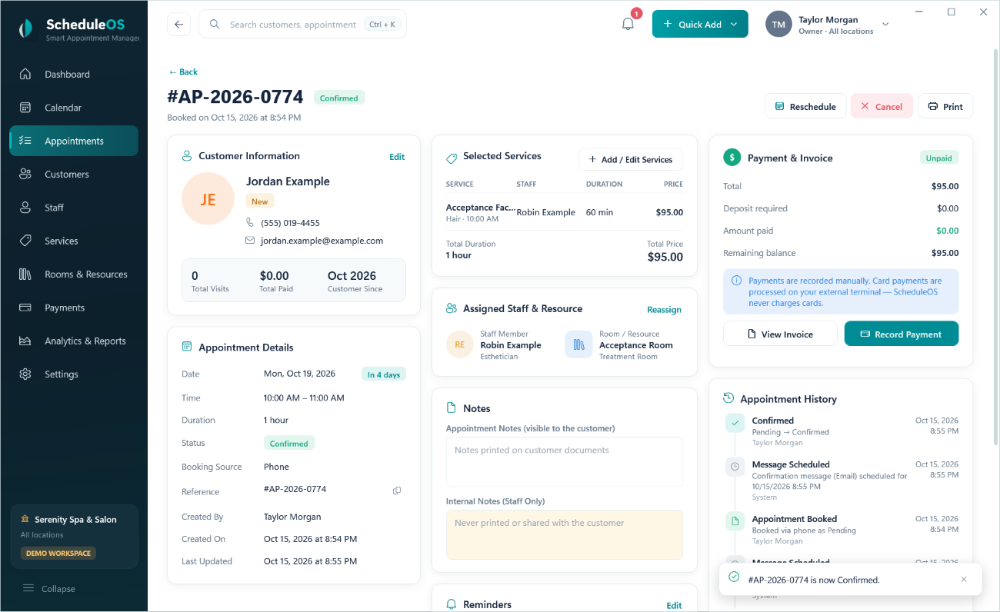</a></td>
  </tr>
  <tr>
    <td><a href="assets/readme/scheduleos-customers.png">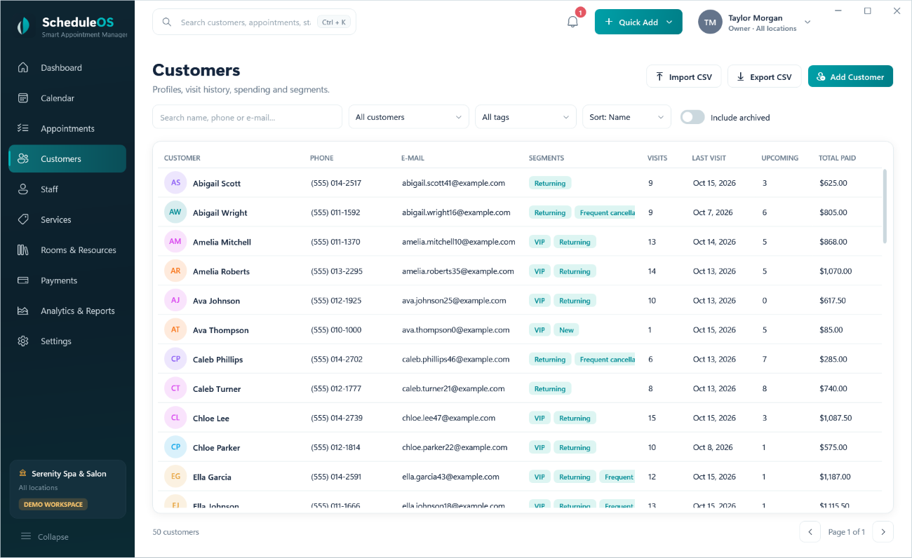</a></td>
    <td>
      <h3>04 — Customer Management</h3>
      <p>Searchable customer profiles include contact details, tags, segments, visit history, upcoming appointments, and total paid.</p>
    </td>
  </tr>
  <tr>
    <td>
      <h3>05 — Staff, Services, and Resources</h3>
      <p>Manage staff profiles and working hours alongside service durations, buffers, pricing, qualifications, rooms, and other bookable resources.</p>
    </td>
    <td><a href="assets/readme/scheduleos-services.png">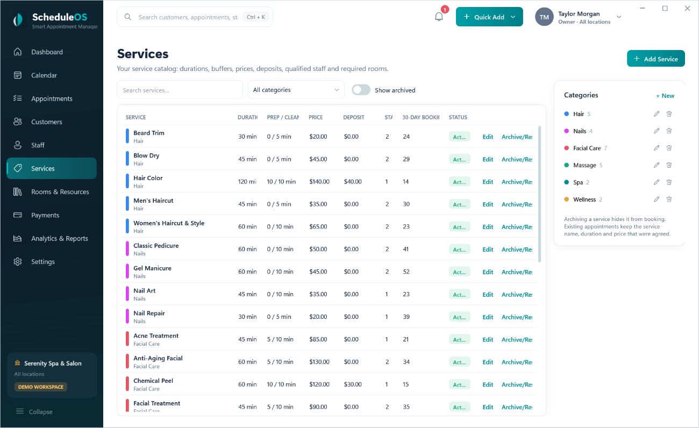</a></td>
  </tr>
  <tr>
    <td><a href="assets/readme/scheduleos-analytics.png">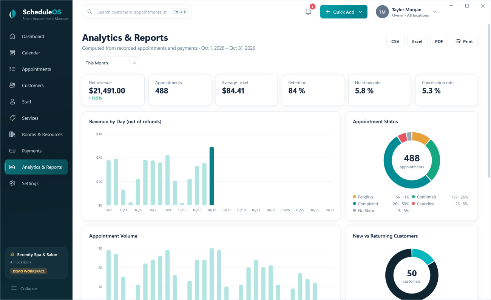</a></td>
    <td>
      <h3>06 — Payments and Analytics</h3>
      <p>Record payments, review balances, generate invoices, and inspect revenue and business reports from the same local workspace.</p>
    </td>
  </tr>
  <tr>
    <td>
      <h3>07 — Settings and Data Protection</h3>
      <p>Business settings, operating hours, roles, appearance, system options, audit history, backup, restore, and database integrity tools are grouped in one settings area.</p>
    </td>
    <td><a href="assets/readme/scheduleos-backup-restore.png">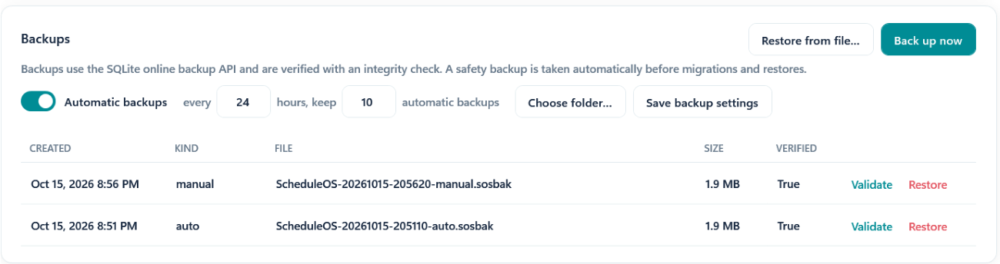</a></td>
  </tr>
</table>

<a id="features"></a>
## Features

### Smart scheduling

- Appointment creation and rescheduling.
- Multiple services and service duration/buffer rules.
- Staff and resource assignment.
- Availability checks and conflict prevention.
- Working hours, breaks, time off, and maintenance blocks.
- Calendar views for day, week, month, and list workflows.

### Business management

- Customer profiles, tags, segments, history, import, and CSV export.
- Staff profiles, skills, service history, working hours, and performance.
- Service catalog with categories, pricing, deposits, durations, preparation, and cleanup.
- Rooms and resources with capacity and availability state.
- Payments, balances, invoices, analytics, and reports.
- Business locations, settings, roles, audit history, and notification configuration.

### Windows desktop experience

- Native WPF/XAML desktop interface.
- Local-first workflow with no cloud service required for the core workspace.
- Global search and keyboard-oriented interaction points.
- Responsive page refreshes with UI automation coverage for the real application.
- Theme and density services in the desktop layer.

### Data and reliability

- SQLite database with Entity Framework Core migrations.
- Transaction-backed write execution and optimistic concurrency checks.
- SQLite online backup with integrity verification.
- Safety backup before restore operations.
- Authentication, permissions, audit records, and privacy-oriented customer operations.

<a id="smart-scheduling-engine"></a>
## Smart Scheduling Engine

### Conflict-Free Scheduling by Design

ScheduleOS treats a booking as a business rule, not only as a calendar visual. Availability is evaluated using the appointment interval together with the staff, resource, working-time, break, time-off, and service buffer constraints that apply to it.

The verified scheduling behavior includes:

- Half-open time intervals for boundary-safe overlap checks.
- Staff availability and working-hour restrictions.
- Breaks, time off, and maintenance periods.
- Service preparation and cleanup buffers.
- Resource capacity and double-booking prevention.
- Conflict detection before an appointment is committed.
- Transaction-backed database mutations and concurrency validation.
- UI and integration coverage for an unavailable staff/resource/time combination.

The current architecture is an offline-first, single-workstation SQLite application. It is not presented as a multi-computer scheduling server or a cloud synchronization system.

<a id="technology-stack"></a>
## Technology Stack

| Layer | Technology | Responsibility |
|---|---|---|
| Language | C# | Application and domain code |
| Desktop | WPF / XAML | Native Windows user interface |
| Runtime | .NET 10 | Application platform |
| Architecture | MVVM | Presentation and workflow separation |
| ORM | Entity Framework Core 10 | Mapping, queries, and migrations |
| Database | SQLite | Local transactional storage |
| UI toolkit | CommunityToolkit.Mvvm | Observable view models and commands |
| Testing | xUnit | Unit and integration verification |
| UI testing | FlaUI UIA3 | Real Windows UI automation |
| Reporting | ClosedXML / PDFsharp | Spreadsheet and PDF reporting paths |
| Logging | Serilog | Local application logging |

<a id="architecture"></a>
## Architecture

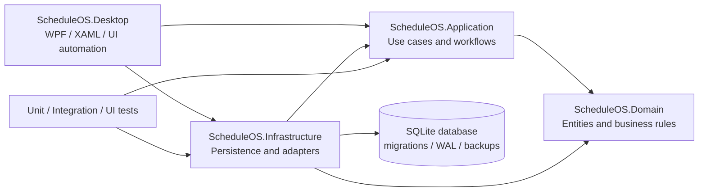

The desktop layer composes the application and infrastructure services. Application workflows depend on domain concepts and abstractions, while infrastructure provides SQLite persistence, backup, logging, seeding, and external adapters. The tests exercise the application through focused unit/integration suites and through the real WPF executable.

<a id="windows-desktop-release"></a>
## Windows Desktop Release

The verified local release is a native WPF application published for Windows x64:

- Self-contained deployment.
- Single-file executable.
- `PublishTrimmed=false` for predictable WPF runtime behavior.
- First-run owner onboarding and demo workspace setup.
- Offline-first SQLite storage.
- Published executable exercised by the full UI acceptance journey.

Release artifact:

```text
artifacts/release/win-x64/ScheduleOS.exe
```

Measured release details from the acceptance report:

- Version: `1.0.0`.
- Size: `143,740,679` bytes, approximately `143.7 MB` decimal.
- Published UI acceptance: `PASS`.

The repository does not claim a public download URL or GitHub Release. The Windows installer source is available at [`build/packaging/ScheduleOS.iss`](build/packaging/ScheduleOS.iss); an installer binary requires Inno Setup to be installed locally.

<a id="getting-started"></a>
## Getting Started

### Requirements

- Windows 10/11 x64.
- .NET 10 SDK to build from source.
- An interactive Windows desktop session for WPF UI acceptance tests.
- Visual Studio is optional; the commands below use the .NET CLI.

### Restore and build

```powershell
$env:NUGET_PACKAGES = "$env:USERPROFILE\.nuget\packages"
dotnet restore ScheduleOS.sln --ignore-failed-sources
dotnet build ScheduleOS.sln -c Release --no-restore
```

### Run locally

```powershell
dotnet run --project src\ScheduleOS.Desktop\ScheduleOS.Desktop.csproj -c Debug --no-restore
```

### Test

```powershell
dotnet test tests\ScheduleOS.UnitTests\ScheduleOS.UnitTests.csproj -c Release --no-build --no-restore
dotnet test tests\ScheduleOS.IntegrationTests\ScheduleOS.IntegrationTests.csproj -c Release --no-build --no-restore

# Requires an interactive Windows desktop session.
dotnet test tests\ScheduleOS.UITests\ScheduleOS.UITests.csproj -c Release --no-build --no-restore `
  --filter "FullyQualifiedName~Full_acceptance_journey_on_the_real_application"
```

### Publish Windows x64

```powershell
dotnet publish src\ScheduleOS.Desktop\ScheduleOS.Desktop.csproj `
  -c Release -r win-x64 --self-contained true `
  -p:PublishSingleFile=true -p:PublishTrimmed=false --no-restore `
  -o artifacts\release\win-x64
```

<a id="local-data-storage"></a>
## Local Data Storage

Writable application data is kept outside the executable directory:

| Data | Default location |
|---|---|
| SQLite database | `%LOCALAPPDATA%\ScheduleOS\Data\scheduleos.db` |
| Backups | `%LOCALAPPDATA%\ScheduleOS\Backups` |
| Logs | `%LOCALAPPDATA%\ScheduleOS\Logs` |

Set `SCHEDULEOS_DATA_DIR` to override the data root for tests or a controlled portable deployment. Keeping the database in LocalAppData allows application binaries to be updated without putting user data beside the executable.

Backup and restore use the SQLite online backup API. Backups are integrity-checked, and restore operations create a safety backup before replacing the active database. The installer script intentionally has no uninstall deletion rule for the user data directory.

<a id="testing-and-quality-assurance"></a>
## Testing and Quality Assurance

The latest verified acceptance evidence is in [`docs/FINAL_ACCEPTANCE_REPORT.txt`](docs/FINAL_ACCEPTANCE_REPORT.txt) and [`docs/acceptance/ui-journey.log`](docs/acceptance/ui-journey.log).

| Verification | Result |
|---|---:|
| Release solution build | PASS — 7 projects, 0 warnings, 0 errors |
| Unit tests | PASS — 62/62 |
| Integration tests | PASS — 33/33 |
| UI acceptance on Debug executable | PASS — 1/1 |
| UI acceptance on published executable | PASS — 1/1 |
| NuGet vulnerability audit | No vulnerable packages reported |

The published UI journey covers onboarding, sign-in, dashboard, calendar navigation, customer/service/staff/resource creation, booking, conflict detection, confirmation, rescheduling, payment, invoice, reports, backup, restart persistence, and restore.

There is no claim here of zero defects or of multi-machine/cloud scheduling support. The evidence describes the tested local release journey and the automated coverage that produced it.

<a id="project-structure"></a>
## Project Structure

```text
ScheduleOS.sln
├── src/
│   ├── ScheduleOS.Desktop/          WPF shell, views, view models, UI services
│   ├── ScheduleOS.Application/      use cases, workflows, scheduling, reports
│   ├── ScheduleOS.Domain/           entities, value objects, business rules
│   └── ScheduleOS.Infrastructure/   EF Core, SQLite, backup, logging, seed data
├── tests/
│   ├── ScheduleOS.UnitTests/
│   ├── ScheduleOS.IntegrationTests/
│   └── ScheduleOS.UITests/          FlaUI tests against the real WPF app
├── assets/
│   ├── branding/
│   └── readme/                      optimized copies of real screenshots
├── docs/
│   ├── acceptance/
│   ├── screenshots/                  original acceptance captures
│   └── FINAL_ACCEPTANCE_REPORT.txt
├── build/packaging/                  Inno Setup source
└── README.md
```

<a id="application-gallery"></a>
## Application Gallery

These are real screenshots captured from ScheduleOS WPF during acceptance. The previews use optimized copies in `assets/readme/`; the links open the original capture in `docs/screenshots/` where the original contains no local-path information.

### Featured screens

<table>
  <tr>
    <td width="50%"><a href="assets/readme/scheduleos-dashboard-1440x900.png"></a><br><strong>Business Dashboard</strong></td>
    <td width="50%"><a href="assets/readme/scheduleos-calendar-week.png"></a><br><strong>Smart Calendar</strong></td>
  </tr>
  <tr>
    <td><a href="assets/readme/scheduleos-appointment-detail.png"></a><br><strong>Appointment Detail</strong></td>
    <td><a href="assets/readme/scheduleos-customers.png"></a><br><strong>Customer Management</strong></td>
  </tr>
  <tr>
    <td><a href="assets/readme/scheduleos-services.png"></a><br><strong>Service Catalog</strong></td>
    <td><a href="assets/readme/scheduleos-analytics.png"></a><br><strong>Analytics and Reports</strong></td>
  </tr>
</table>

<details>
<summary><strong>Explore all 23 real application screenshots</strong></summary>

#### Onboarding and dashboard

<table>
  <tr>
    <td width="50%"><a href="docs/screenshots/00-onboarding.png">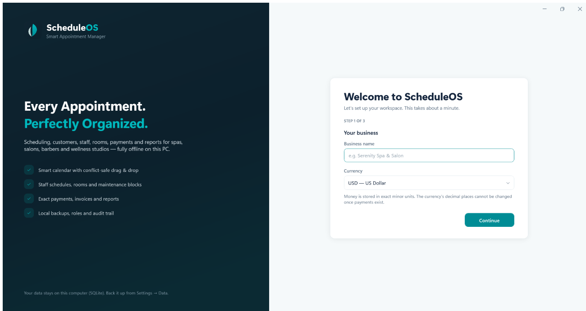</a><br><strong>Onboarding</strong><br><sub>First-run owner and workspace setup</sub></td>
    <td width="50%"><a href="docs/screenshots/01-dashboard.png">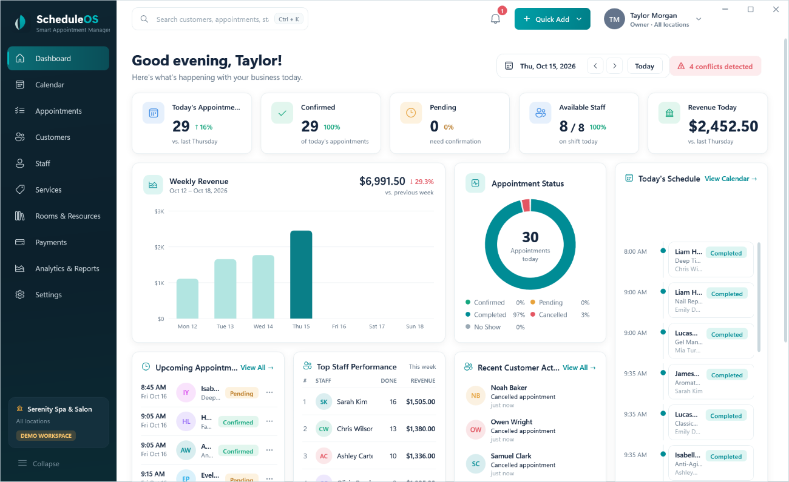</a><br><strong>Dashboard — base capture</strong></td>
  </tr>
  <tr>
    <td><a href="docs/screenshots/01-dashboard-1280x800.png">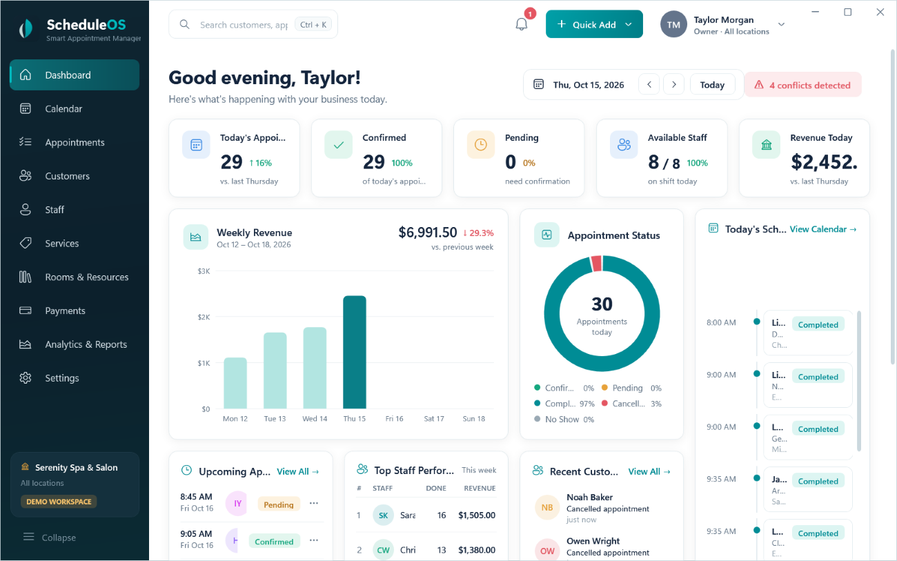</a><br><strong>Dashboard — compact viewport</strong></td>
    <td><a href="docs/screenshots/01-dashboard-1440x900.png"></a><br><strong>Dashboard — featured viewport</strong></td>
  </tr>
  <tr>
    <td><a href="docs/screenshots/01-dashboard-1920x1080.png">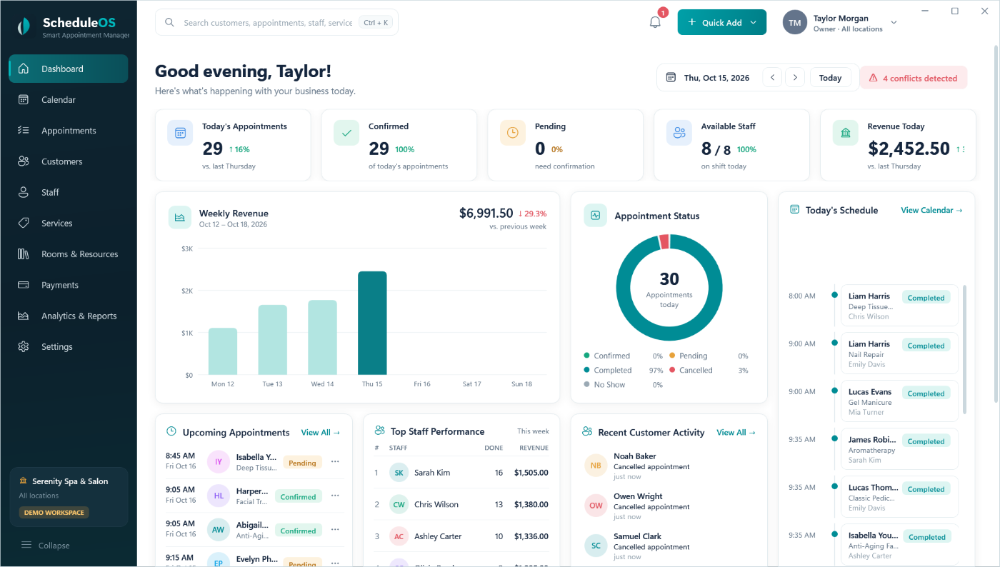</a><br><strong>Dashboard — wide viewport</strong></td>
    <td></td>
  </tr>
</table>

#### Calendar and scheduling

<table>
  <tr>
    <td width="50%"><a href="docs/screenshots/02-smart-calendar.png"></a><br><strong>Calendar — week/range</strong></td>
    <td width="50%"><a href="docs/screenshots/02b-calendar-day-by-staff.png">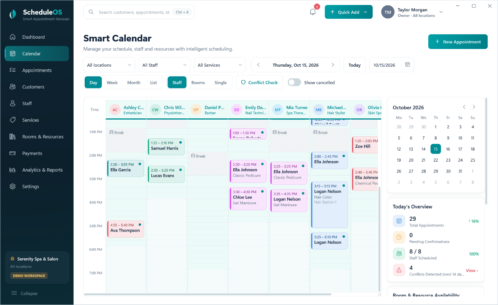</a><br><strong>Calendar — day by staff</strong></td>
  </tr>
  <tr>
    <td><a href="docs/screenshots/02c-calendar-month.png">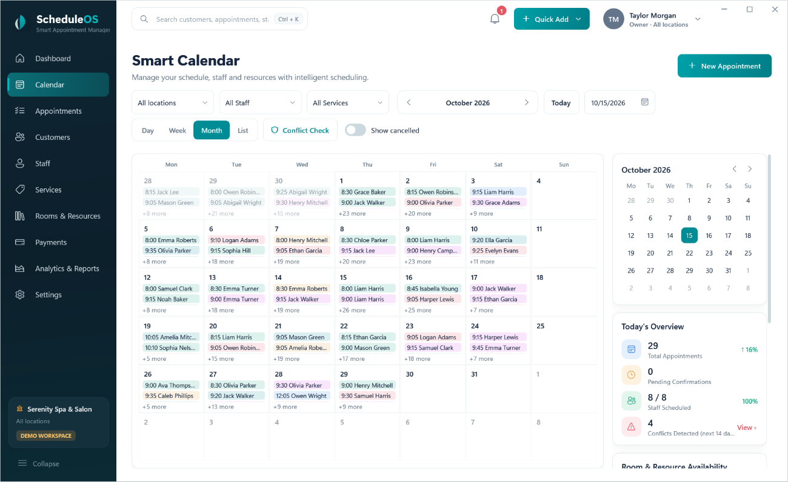</a><br><strong>Calendar — month</strong></td>
    <td></td>
  </tr>
</table>

#### Appointment workflows

<table>
  <tr>
    <td width="50%"><a href="docs/screenshots/03-appointment-detail.png"></a><br><strong>Appointment detail</strong></td>
    <td width="50%"><a href="docs/screenshots/03b-reschedule.png">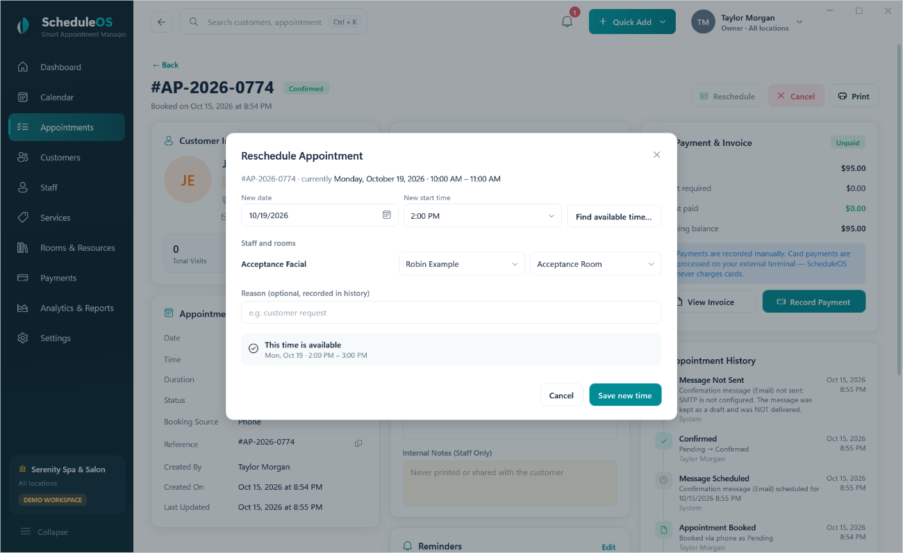</a><br><strong>Reschedule workflow</strong></td>
  </tr>
  <tr>
    <td><a href="docs/screenshots/04-new-appointment.png">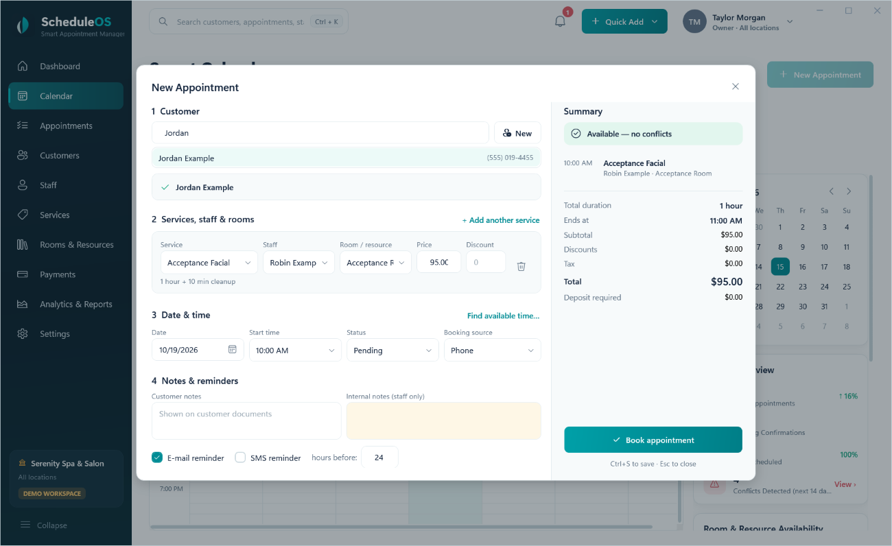</a><br><strong>New appointment</strong></td>
    <td><a href="docs/screenshots/04b-conflict-detected.png">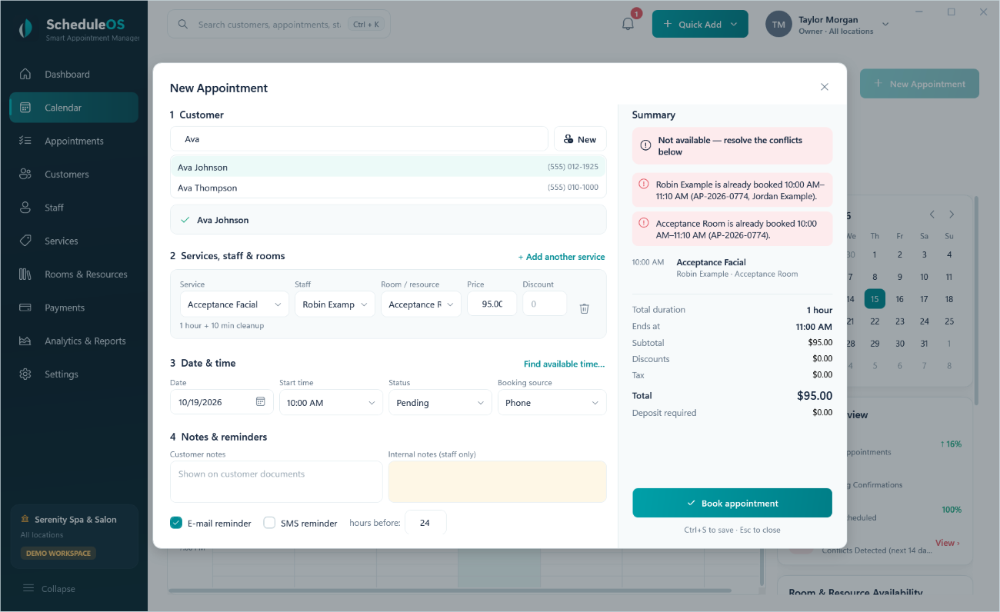</a><br><strong>Conflict detected</strong></td>
  </tr>
  <tr>
    <td><a href="docs/screenshots/04c-conflict-dialog.png">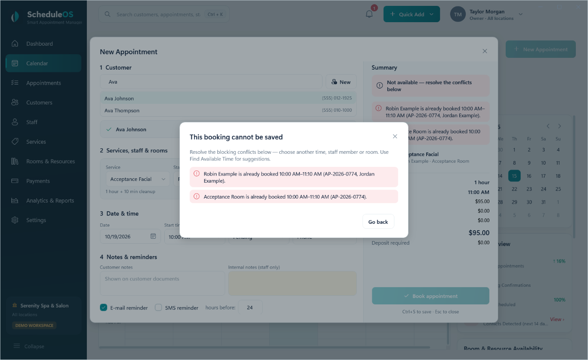</a><br><strong>Conflict dialog</strong></td>
    <td></td>
  </tr>
</table>

#### People, services, and resources

<table>
  <tr>
    <td width="50%"><a href="docs/screenshots/05-customers.png"></a><br><strong>Customers</strong></td>
    <td width="50%"><a href="docs/screenshots/06-staff.png">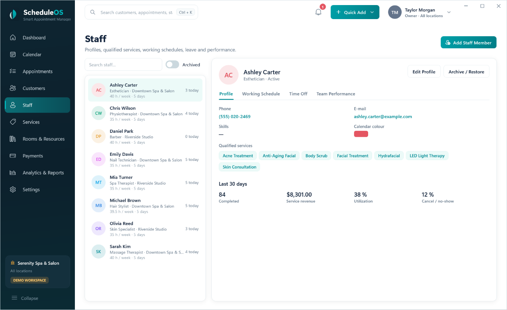</a><br><strong>Staff</strong></td>
  </tr>
  <tr>
    <td><a href="docs/screenshots/06b-staff-schedule.png">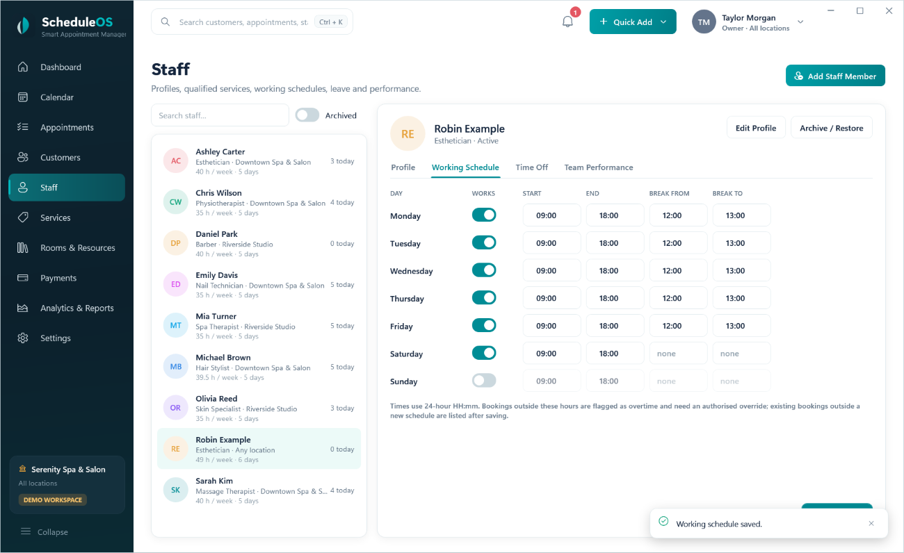</a><br><strong>Staff working schedule</strong></td>
    <td><a href="docs/screenshots/07-services.png"></a><br><strong>Services</strong></td>
  </tr>
  <tr>
    <td><a href="docs/screenshots/07b-resources.png">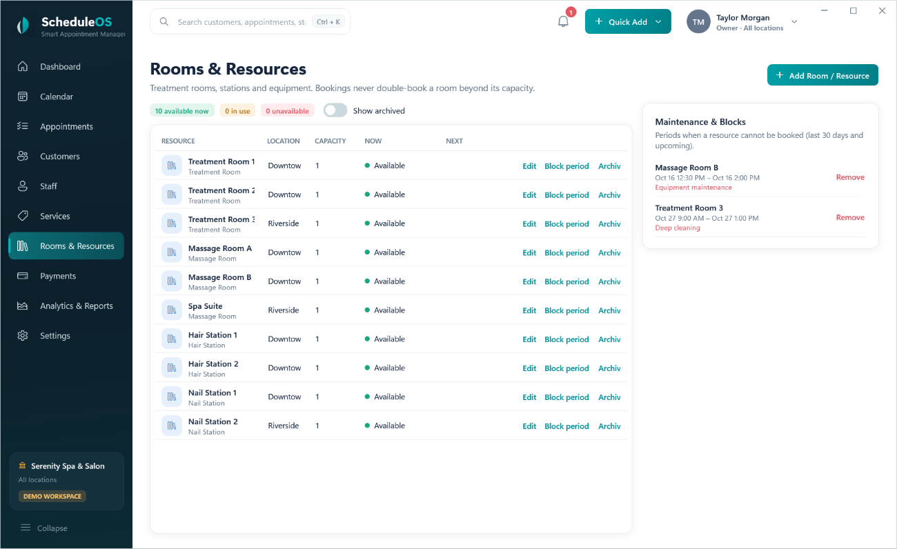</a><br><strong>Rooms and resources</strong></td>
    <td></td>
  </tr>
</table>

#### Payments, reports, and protection

<table>
  <tr>
    <td width="50%"><a href="docs/screenshots/08-payments.png">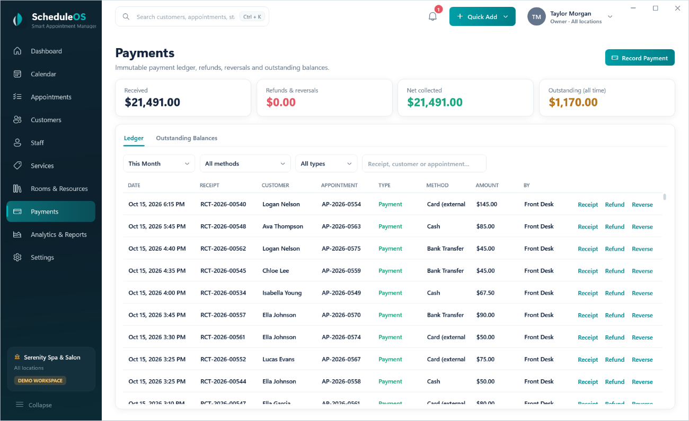</a><br><strong>Payments</strong></td>
    <td width="50%"><a href="docs/screenshots/08b-invoice.png">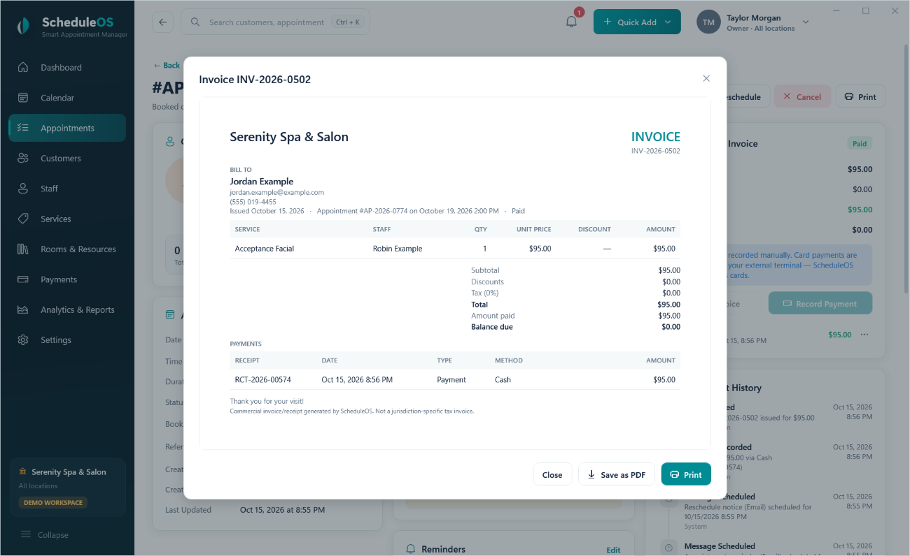</a><br><strong>Invoice</strong></td>
  </tr>
  <tr>
    <td><a href="docs/screenshots/09-analytics.png"></a><br><strong>Analytics</strong></td>
    <td><a href="docs/screenshots/10-settings.png">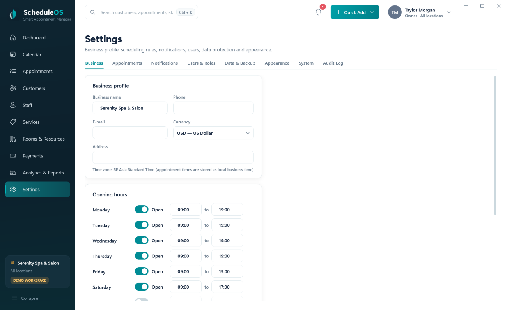</a><br><strong>Settings</strong></td>
  </tr>
  <tr>
    <td><a href="assets/readme/scheduleos-backup-restore.png"></a><br><strong>Backup and restore</strong><br><sub>Privacy-safe crop from the real acceptance capture; the original contained a local temporary path and remains unchanged outside the README asset pipeline.</sub></td>
    <td></td>
  </tr>
</table>
</details>

### README asset pipeline

- 23 original PNG captures remain unchanged in `docs/screenshots/`.
- 23 README-optimized PNG copies are stored in `assets/readme/`.
- Original total: `6,059,231` bytes.
- Optimized total: `5,389,735` bytes.
- Standard previews are resized without stretching and remain readable at GitHub widths.
- The backup preview is a crop of the real backup panel to avoid exposing a local Windows username/path.

<a id="project-status"></a>
## Project Status

### Implemented and verified

- Native WPF desktop shell and onboarding.
- Dashboard, calendar, customers, staff, services, resources, payments, reports, and settings modules.
- Appointment conflict detection, confirmation, rescheduling, invoice, backup, restore, and restart persistence.
- SQLite migrations, integrity checks, audit paths, permissions, and concurrency behavior covered by automated tests.
- Self-contained Windows x64 executable passed the full release UI journey.

### Available as a local desktop release

The verified executable is available from the local build output at `artifacts/release/win-x64/ScheduleOS.exe`. It is not linked as a public release because no GitHub Release has been created.

### Not yet distributed

The Inno Setup source is present, but an installer binary is not claimed as built on the current machine because `iscc.exe` was unavailable.

<a id="roadmap"></a>
## Roadmap

These are future directions, not implemented claims:

- Build and distribute the Windows installer.
- Multi-computer scheduling through a central server.
- Online customer booking portal.
- Cloud synchronization.
- Automatic update distribution.

<div align="center">
  <br>
  <strong>SCHEDULEOS</strong><br>
  <sub>SMART APPOINTMENT MANAGER</sub><br>
  <em>Every Appointment. Perfectly Organized.</em>
  <br><br>
  <a href="#overview">Back to top</a>
</div>
